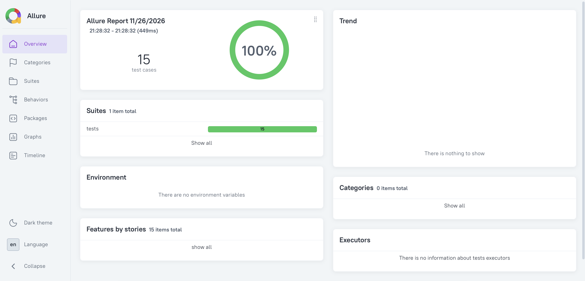
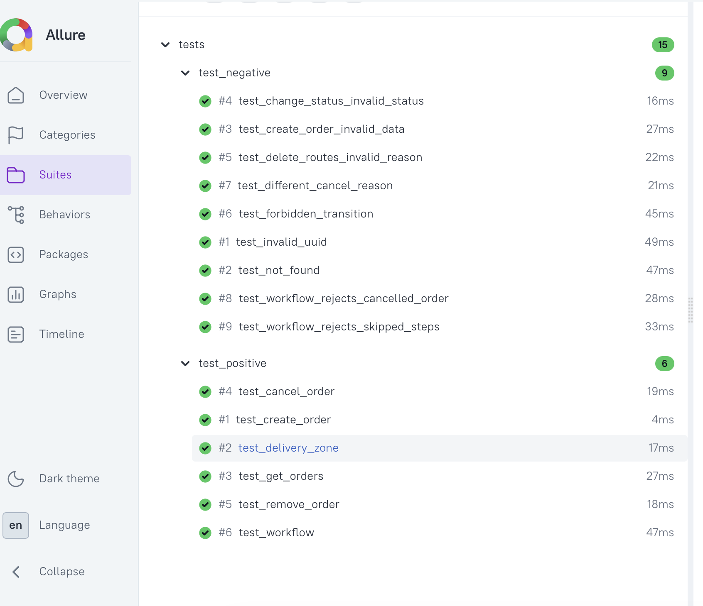

Первое дз по автотестам, где надо просто протестировать приложение

## Как запустить

Из директории `hw-12-01-autotests`:

- В идеале сделать виртуальную среду для питона: `python -m venv .venv && source .venv/bin/activate`
- Установить зависимости: `pip install -r requirements.txt`
- Запуск тестов просто так: `python -m pytest tests -v`
- Запуск тестов с allure: `python -m pytest tests -v --alluredir=allure-results`
- Посмотреть allure: `allure serve allure-results`

Скриншот allure отчета:

